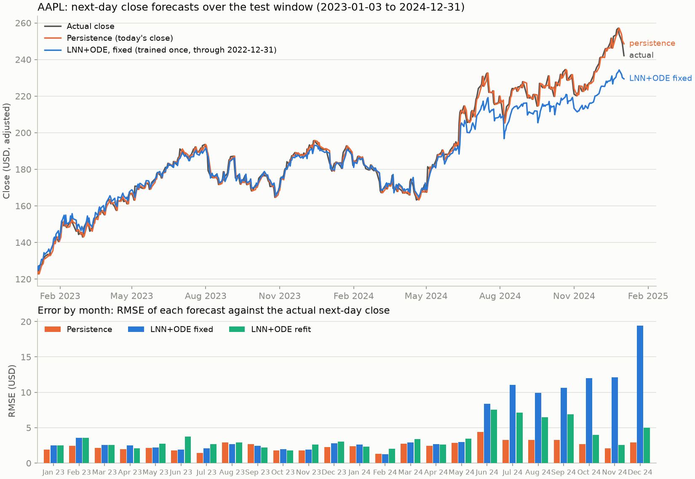

# Liquidity

A research prototype from October 2024: next-day stock-price prediction with a liquid neural
network cell followed by a neural ODE, served from a FastAPI backend over a websocket to a React
chart. Built to learn how liquid time-constant networks and `torchdiffeq` behave on noisy
financial series, not to trade with.

## What is in the repository

```
Liquidity.ipynb        research notebook: data exploration, indicators, the LNN+ODE model on TSLA
backend/
  model_definition.py  LNNCell -> ODEFunc (solved with torchdiffeq.odeint) -> linear head
  train_model.py       fit_model()/predict(); the script trains on daily AAPL closes since 2010
  evaluate.py          walk-forward comparison against persistence and other baselines
  model_inference.py   loads the weights, predicts from one feature row
  data_processing.py   cached yfinance download (data/, gitignored) and feature construction
  main.py              FastAPI: /historical-data, /predict, websocket /ws/predictions
  lnn_ode_model.pth    trained weights (committed; 64-unit hidden state)
  tests/               pytest: model, scalers, features, metrics (no network)
  requirements.txt     pinned versions; requirements-dev.txt adds pytest
results/               walk_forward.md / .csv, predictions.csv, figures/ from the last evaluation run
frontend/              React app: ticker selector, historical chart, live prediction chart
Makefile               install, test, evaluate, report, train, serve
docker-compose.yml     backend on :8000, frontend on :3000
.github/workflows/     tests on push (CPU torch)
```

## The model

Input is a four-feature row per day: close, 20-day and 50-day moving averages, and daily return,
standardised with scikit-learn's `StandardScaler`. The target is the next day's close.

1. **Liquid cell.** `h = h0 + (-lambda * h0 + tanh(W x + U h0 + b))`, with a learned per-unit
   time constant `lambda`. This is one explicit Euler step of a liquid time-constant unit from a
   zero initial state.
2. **Neural ODE.** The cell's state is integrated from t=0 to t=1 by `torchdiffeq.odeint` with a
   two-layer tanh MLP as the vector field.
3. **Head.** A linear layer maps the final state to one value.

Training: MSE loss, Adam at 1e-3 with weight decay 1e-4, batch size 128, 50 epochs, hidden size
64.

## Results from the notebook (TSLA, ten years of daily data, run on Colab, October 2024)

| Metric | Validation set | All data |
|---|---|---|
| RMSE (USD) | 21.75 | 14.24 |
| MAE (USD) | 18.31 | 9.78 |
| R squared | 0.669 | 0.984 |

The "all data" column includes the training period and is reported only because the notebook
prints it; the validation column is the honest number. Training loss fell from 0.090 to the
low 0.01s over 50 epochs with validation loss tracking it. On their own these numbers say
nothing about predictive value, because for next-day prices a naive forecast scores in the same
range; the walk-forward comparison in the next section settles that.

## Does it beat persistence?

No. `backend/evaluate.py` trains on every (features on day t, close on day t+1) pair whose
target falls on or before 2022-12-31, then forecasts the next close for each trading day from
2023-01-03 to 2024-12-31 (502 forecasts per ticker), once with the model left fixed and once
refitting it from scratch every 63 trading days on all data available at that point (7 refits).
Scalers are fitted on the training rows only; seed 0, 50 epochs, hidden size 64, the same
hyperparameters as `train_model.py`. Baselines: persistence (predict today's close), ordinary
least squares on the same four features, and the mean of the last five closes. Run on
2026-10-22 (UTC) with `make evaluate` (`cd backend && python evaluate.py`), 28 minutes on a
laptop CPU, torch 2.14.1, yfinance auto-adjusted closes downloaded the same day.

RMSE in USD over the test window, with RMSE as a percentage of the mean test-window price in
parentheses so the tickers are comparable:

| Ticker | Persistence | LNN+ODE, fixed | LNN+ODE, refit every 63 d | Linear regression, fixed | 5-day moving average | Directional accuracy, LNN+ODE fixed / refit | Share of up days |
|---|---|---|---|---|---|---|---|
| AAPL | 2.54 (1.35%) | 7.03 (3.74%) | 3.95 (2.10%) | 2.54 (1.35%) | 3.93 (2.09%) | 48.8% / 46.0% | 56.2% |
| TSLA | 8.69 (3.87%) | 10.50 (4.68%) | 11.18 (4.98%) | 8.69 (3.87%) | 13.31 (5.92%) | 49.6% / 52.0% | 52.6% |
| MSFT | 4.94 (1.37%) | 15.96 (4.43%) | 6.89 (1.91%) | 4.94 (1.37%) | 6.98 (1.94%) | 49.4% / 47.8% | 54.4% |
| SPY | 3.79 (0.81%) | 15.40 (3.28%) | 5.97 (1.27%) | 3.80 (0.81%) | 5.75 (1.23%) | 47.4% / 45.6% | 57.4% |

What the numbers show:

- Persistence and the linear regression tie for the lowest RMSE on all four tickers (they are
  within 0.015 USD of each other; the regression is nominally ahead on TSLA and MSFT, by less than
  0.005 USD). The fixed LNN+ODE model is 1.2x (TSLA) to 4.1x (SPY) worse than persistence.
  Refitting every quarter brings it to 1.3x to 1.6x worse, roughly the level of the 5-day moving
  average, and on TSLA refitting made it slightly worse than the fixed model.
- The linear regression on the same four features matches persistence to within 0.02 USD on
  every ticker: with today's close among the inputs, least squares learns to copy it, and that
  copy is all the forecastable signal these features carry.
- Directional accuracy of the LNN+ODE model is between 45.6% and 52.0%, coin-flip level, and on
  every ticker below the share of up days (52.6% to 57.4%) that always predicting "up" would have
  scored in this rising two-year window.
- The model's error is mostly a negative bias. The fixed model under-predicts by 3.17 USD (AAPL)
  to 10.80 USD (MSFT) on average, and the error grows once prices move above the range the
  weights and scalers saw in training; in the figure below the AAPL error jumps from June 2024
  onwards. Refitting shrinks the bias (to 1.55 to 2.95 USD) but does not remove it. MAE gives the same
  conclusion: on every ticker both LNN+ODE variants have a higher MAE than persistence and both
  linear regressions. The only rank changes between the two metrics are among persistence and the
  two regressions, which differ by hundredths of a dollar, and between the refit model and the
  5-day moving average on AAPL.

So on next-day close the model does not beat persistence, does not beat a four-feature linear
regression, and shows no directional skill in this test. The notebook's RMSE and R squared were
measuring how well a price series tracks itself. Caveats: one seed (seed-to-seed variation was
not measured), one test window, and adjusted closes as downloaded on 2026-10-22. Full tables with
MAE and bias are in [`results/walk_forward.md`](results/walk_forward.md), the per-day forecasts
in `results/predictions.csv`, and `make report` rebuilds both plus the figure from that file.




## Running it

With Docker:

```bash
docker compose up --build        # backend http://localhost:8000, frontend http://localhost:3000
```

Without Docker:

```bash
python -m venv .venv && source .venv/bin/activate
make install                     # backend/requirements-dev.txt (pinned; Python 3.11)
make test                        # pytest backend/tests, no network
make serve                       # uvicorn on :8000: GET /historical-data, GET /predict, WS /ws/predictions
make train                       # optional: retrains on AAPL, overwrites backend/lnn_ode_model.pth
make evaluate                    # walk-forward evaluation, writes results/ (about 30 min on a laptop CPU)
make evaluate-fixed              # the no-refit variant only (about 4 min)
make report                      # rebuild results/ tables and figure from results/predictions.csv
```

The `make` targets are one-liners over `backend/*.py`; see the `Makefile` for the exact
commands. Daily bars are downloaded from yfinance once per ticker and cached in `data/`
(gitignored); pass `--refresh` to `train_model.py` to re-download. For a CPU-only torch install
first `pip install torch==2.14.1 --index-url https://download.pytorch.org/whl/cpu`, as the CI
workflow does.

```bash
cd frontend && npm install && npm start
```

## State of the code (updated 2026-10-22)

The 2024 prototype had three defects that stopped the backend from working from a fresh clone, all
fixed in the October 2026 commit:

- the committed `lnn_ode_model.pth` was an empty file; it is now real weights from `train_model.py`
  (50 epochs on AAPL, final training MSE 0.00078 in standardised units) with the fitted scalers in
  `scalers.joblib`;
- serving built features from one day of one-minute bars while training used daily bars, and fed
  them unscaled; `/predict` now builds the same daily feature row as training, scales it, and
  inverts the target scaling so the response is a price;
- `yfinance` now returns multi-level columns and pandas dropped `fillna(method=...)`; both handled.

`/predict` and the websocket accept `?symbol=` (default `AAPL`). The frontend selector is still not
wired to it, and the training ticker is still hard-coded. The October 2026 commits add the
walk-forward evaluation above, unit tests with a CI workflow, pinned requirements and a Makefile;
the served weights are unchanged. Given the evaluation, treat the model as a learning exercise.

## Disclaimer

Educational project. Nothing here is financial advice or suitable for trading.

## License

MIT, see `LICENSE`.
